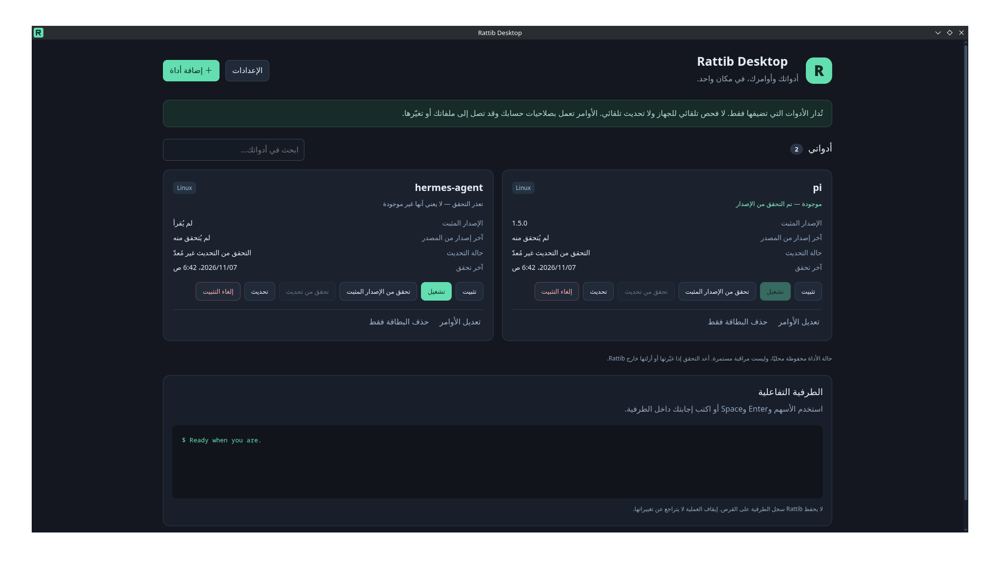

<p align="center">
  
</p>

<h1 align="center">Rattib Desktop</h1>

<div dir="rtl">

**أدواتك وأوامرك، في مكان واحد.**

تطبيق مكتبي محلي لإدارة أدوات سطر الأوامر التي تضيفها أنت يدويًا، مع طرفية تفاعلية للتشغيل والتثبيت والتحديث والإزالة. لا يفهرس البرامج أو ملفات الجهاز، ولا ينفذ شيئًا بمجرد فتح التطبيق.

</div>

**Your tools and commands, in one place.**

A local desktop manager for CLI tools you add manually, with an interactive terminal for launching, installing, updating and uninstalling. It does not index your programs or files, and it runs no commands merely because you open the application.

[العربية](#العربية) · [English](#english)

<p align="center">
  
</p>

## العربية

> **نسخة أولية تجريبية.** لا تعتبر نجاح البناء دليلًا على سلامة أمر التثبيت أو دعم كل توزيعات لينكس. اختبر المثبتات داخل بيئة يمكن الاستغناء عنها. التطبيق ليس عازلًا أمنيًا للأوامر.

### الوظائف الحالية

- إضافة اسم الأداة وأوامرها يدويًا، وتعديل تعريفها أو حذفه.
- إعداد مستقل لكل من Linux وmacOS وWindows، مع اختيار shell المناسب.
- أوامر منفصلة للتشغيل، التثبيت، قراءة الإصدار المثبت، التحديث، والإزالة. أُزيل زر «تحقق من التحديث» وحقله وحالة المقارنة من الواجهة.
- التحقق من وجود الأداة بأمر الإصدار عند النقر على التثبيت أو التحقق من الإصدار أو التحديث، دون خيار ربط يدوي.
- حفظ حالة الأداة والإصدار بين مرات فتح التطبيق، ومنع تشغيل المثبّت للأداة المعروفة كموجودة.
- طرفية PTY حقيقية عبر `node-pty` و`xterm.js`: الأسهم، Enter، Space، النصوص، والأسئلة الرقمية تصل إلى البرنامج نفسه.
- لا تحويل تلقائي لقوائم البرامج إلى قوائم رسومية، ولا إجابات تلقائية.
- عرض الأمر وطلب موافقة صريحة قبل تشغيله، وعملية واحدة في الوقت نفسه.
- حفظ التعريفات محليًا فقط. لا حساب ولا خدمة سحابية مطلوبة.
- لا حفظ لسجل الطرفية على القرص بواسطة Rattib. قد تحفظ الأداة نفسها سجلاتها.
- واجهة عربية وإنجليزية؛ تغيير اللغة وحفظها فور اختيارها من الإعدادات دون زر تأكيد.
- أشرطة تمرير للنصوص والنوافذ والطرفية بألوان التطبيق الداكنة.
- أوامر معزولة باتجاه LTR وعرض عربي متصل داخل الطرفية، مع استمرار إدخال الأسهم والأرقام والنصوص إلى العملية نفسها.

### الاستخدام

1. اضغط **إضافة أداة** وأدخل اسمها.
2. اختر النظام وبيئة التشغيل، ثم أدخل الأوامر المطلوبة فقط.
3. في كل خانة مثال خافت وشرح: `strata` للتشغيل، `strata --version` للإصدار، `strata update` للتحديث، `strata uninstall` للإزالة، و`npm install -g <package-name>` للتثبيت. هذه أمثلة فقط؛ استخدم الأوامر التي تدعمها أداتك وطريقة تثبيتها، ولا تُنفّذ الأمثلة أو تُحفظ تلقائيًا. ترك الخانة فارغة يعطّل زرها. يحتاج التثبيت والتحديث أيضًا أمر الإصدار للتحقق من وجود الأداة.
4. عند التشغيل راجع نافذة التأكيد، ثم أجب عن الأسئلة داخل الطرفية بنفسك.

مثال تعريفي يطابق الفكرة المطلوبة، **وليس توثيقًا لصحة جميع أوامر Pi**:

| الحقل | مثال مدخل يدويًا |
|---|---|
| الاسم | Pi |
| التثبيت على نظام يدعم الأمر | `curl -fsSL https://pi.dev/install.sh \| sh` |
| قراءة الإصدار | `pi -v` |
| التشغيل | `pi` |
| التحديث | أمر التحديث الرسمي حسب طريقة تثبيت الأداة؛ ليس `pi -v` |
| الإزالة | `pi uninstall` |

تحقق من أوامر التحديث والإزالة الفعلية في توثيق الأداة قبل حفظها. الأمر `hermes uninstall --full` مثلًا، إذا أضفته، يعمل في الطرفية وستكتب أنت اختيارك عند `Select option [1/2/3]:`.

**حذف البطاقة** يحذف تعريف الأداة من Rattib فقط، ولا يلغي تثبيتها. **إلغاء التثبيت** يشغّل أمر الإزالة الذي أدخلته.

#### التحقق من وجود الأداة دون ربط يدوي

- أدخل أمر الإصدار، مثل `pi -v`، مرة في **تعديل الأوامر**.
- **تثبيت:** يُفحص الإصدار كل مرة بعد موافقتك، حتى لو حُفظت حالة سابقة. إذا وُجد إصدار واضح، تُحفظ الحالة ولا يُشغّل المثبّت. يبقى الزر متاحًا لإعادة الفحص، ولا يتطلب نسيان الحالة.
- إذا تعذر التحقق فلا يُفترض غياب الأداة؛ يظهر الناتج ويحتاج تشغيل المثبّت إلى تأكيد مستقل وصريح رغم عدم اليقين. أمر التثبيت نفسه لا يبدأ تلقائيًا.
- **تحقق من الإصدار المثبت:** يُشغّل أمر الإصدار ويحدّث حالة الوجود والإصدار المحفوظ.
- **تحديث:** يُفحص الإصدار أولًا. إذا تعذر التحقق فلن يُشغّل تحديث أو تثبيت. إذا نجح، تُعرض موافقة مستقلة لأمر التحديث. بعد نجاح التثبيت أو التحديث يُقرأ الإصدار مجددًا لحفظ الحالة الفعلية.
- تعمل مراحل الفحص والتنفيذ وإعادة الفحص في جلسة طرفية واحدة، مع إظهار الأمر الجاري. إيقاف العملية يمنع الانتقال للمراحل اللاحقة.
- لا يوجد خيار ربط يدوي أو API للربط. تبقى بيانات الإصدار 0.2.0 القديمة مقروءة، لكن حالة الربط القديمة لا تُعد تحققًا فعليًا.
- **أمر تشغيل** يفتح الأداة داخل الطرفية؛ نجاحه لا يثبت وجود إصدار معروف ولا يغيّر حالة الوجود من تلقاء نفسه.
- **تعديل الأوامر** يغيّرها دون حذف البطاقة. تعديل أمر التحديث وحده يحفظ الحالة السابقة؛ تغيير أمر التعرف أو بيئة التشغيل يبطلها.

#### اللغة واتجاه العربية

من **الإعدادات → لغة الواجهة** اختر **English** أو **العربية**. يتغير اتجاه الواجهة ورسائل التأكيد ويُحفظ الاختيار فورًا دون زر تأكيد؛ كذلك يُحفظ خيار العرض العربي مباشرة. لا تتغير لغة الأداة الخارجية تلقائيًا.

عند ظهور العربية، يستخدم **العرض العربي المتصل** أسطرًا كاملة في مساحة الطرفية لضم الحروف بواسطة المتصفح بدل رسم كل حرف في خلية منفصلة. انقر داخل الطرفية واكتب أو استخدم الأسهم وEnter؛ تبقى معالجة الإدخال واللصق وIME والفحص عبر xterm وPTY كما هي، دون قلب البايتات أو إعادة تشكيل الأوامر. يتابع العرض شاشة الطرفية الحالية والتمرير وتغييرات القوائم بدل تكديس سجل قديم. يمكن الرجوع إلى **العرض الأصلي** دون إعادة تشغيل العملية؛ استخدمه للواجهات المعتمدة على الماوس أو تخطيط الخلايا الدقيق أو الألوان التي لا يحافظ عليها العرض العربي بالكامل. يمكن إيقاف التبديل العربي التلقائي من الإعدادات.

#### أيقونة التطبيق على Linux

تحتوي الحزم على أيقونات hicolor بالأحجام 16 و24 و32 و48 و64 و128 و256 و512 بدل صورة 1024 وحدها، مع تطابق هوية `.desktop` ونافذة التطبيق. يفحص اختبار تثبيت Arch ملفات الأيقونات وصحة cache قبل أول تشغيل.

لنسخ AppImage والأرشيف المحمول، افتح **الإعدادات → إضافة اختصار إلى قائمة التطبيقات**. بعد تأكيدك يُكتب اختصار وأيقونة لهذا المستخدم فقط، دون تشغيل أمر أداة. أعد إنشاء الاختصار إذا نقلت ملف التطبيق. صورة ملف AppImage في مدير الملفات تعتمد أيضًا على تكامل مدير الملفات؛ لا يفرض Rattib أيقونة ملف عامة على النظام.

#### الإصدار والتحديث

- `pi -v` يقرأ الإصدار المحلي، ولا يبحث عن تحديث ولا يثبّته. لا تفترض أن كل نسخة من Pi تدعم `pi update`؛ استخدم أمر التحديث الموثق لطريقة تثبيتك.
- التحقق من الإصدار يشغّل أمر الإصدار المحلي فقط. التحديث يفحص الإصدار، ثم يشغّل المحدّث بعد موافقة مستقلة، ثم يفحص الإصدار مجددًا.
- أُزيل خيار «تحقق من التحديث» من البطاقات والمحرر، مع بيانات المقارنة. تُحفظ تعريفات مصدر الإصدار القديمة داخليًا للتوافق، دون زر لتشغيلها في الواجهة.
- تعرض نافذة التحديث الأولى أمر المحدّث الفعلي والفحص اللاحق، وتظهر مراحل التنفيذ في الطرفية. إذا كان أمر التحديث مطابقًا لأمر الإصدار المحلي، يُعطّل الزر مع توضيح السبب؛ أصلح الحقل في **تعديل الأوامر**. لا تُستبدل أوامرك تلقائيًا.
- يُستخرج رقم ثلاثي واضح مثل `1.5.0` بعد خروج ناجح فقط. إذا وُجدت أرقام إصدارات متعددة مختلفة لا يخمّن التطبيق.
- معلومات الإصدار وحالة الوجود محفوظة محليًا وليست مراقبة مستمرة. أعد الفحص إذا حذفت الأداة أو غيّرتها خارج Rattib. التثبيت والتحديث والإزالة يبطلون تحقق الإصدار المحلي السابق؛ يعاد الفحص بعد نجاح التثبيت أو التحديث، ويمكن طلبه يدويًا بعد الإزالة.
- نجاح أمر لا يثبت اكتمال التثبيت. اضغط قراءة الإصدار للتحقق.

### الخصوصية والأمان

Rattib يقرأ إعداداته المحلية فقط عند البداية، ولا يبحث عن الأدوات تلقائيًا. لكن **الأوامر التي تختار تشغيلها تعمل بصلاحيات حسابك وقد تقرأ أو تغيّر أو تحذف ملفاتك**. لا يوجد عزل للمثبتات أو ضمان لأمان `curl | sh`.

- لا تخزّن كلمات المرور أو مفاتيح API في الأوامر. ملف التعريفات ليس خزنة مشفرة.
- لا يُضاف `sudo` تلقائيًا ولا تُوافق الأسئلة تلقائيًا.
- إيقاف PTY لا يتراجع عن التغييرات، وقد لا ينهي عمليات منفصلة أطلقتها الأداة.
- واجهة Electron معزولة: `contextIsolation` و`sandbox` مفعّلان و`nodeIntegration` معطّل، وسياسة CSP محلية، ومنع نوافذ/تنقلات الويب الجديدة وطلبات الصلاحيات.
- تنفيذ الأوامر محصور في IPC لإجراءات محفوظة، وليس API عامة لتمرير أمر من الواجهة دون مراجعة.
- التعريفات محفوظة في `tools.json`، وتفضيلات اللغة في `settings.json`، وحالة الأداة وأرقام الإصدارات وتواريخ التحقق في `presence.json` داخل مسار `userData` الخاص بـ Electron. لا يُحفظ ناتج الأوامر في ملف الحالة. قد يختلف المسار حسب بيئة النظام، وداخل Flatpak يكون ضمن بيانات التطبيق المعزولة.

**لا ترسل رموز GitHub في المحادثات أو القضايا.** إذا انكشف رمز فألغِه فورًا. البناء السحابي يستخدم `GITHUB_TOKEN` المدمج، ولا يحتاج PAT محفوظًا في المشروع. صلاحية كتابة الإصدارات محصورة في مهمة نشر المسودة.

### التقنية والتطوير

Electron + TypeScript + React + Vite، وطرفية `xterm.js` مع `node-pty`.

يلزم Node.js **24 أو أحدث**، وأدوات C/C++ وPython لإعادة بناء الإضافة الأصلية عند الحاجة. على Windows قد تحتاج Visual Studio Build Tools بمكونات C++ ومعمارية الهدف؛ استخدام WSL لتشغيل أداة يتطلب تثبيت WSL فعلًا.

```sh
npm ci
npm run dev
```

```sh
npm run check          # TypeScript + اختبارات الوحدة
npm run test:smoke     # نسخة مبنية، ملف تعريف مؤقت، واختبار PTY آمن
npm run package:dir   # تطبيق غير مغلف للنظام الحالي
```

اختبار smoke لا يشغّل مثبت Pi أو Hermes: يستخدم برنامجًا تجريبيًا محليًا فقط لفحص TTY والأسهم والإدخال الرقمي، ومنع تكرار التثبيت، والهجرة من التعريفات القديمة، والتحقق قبل التحديث وبعده والتشغيل، وحفظ الحالة، وتعديل الأوامر دون حذف البطاقة، وتغيير اللغتين الفوري دون تأكيد وألوان أشرطة التمرير وعرض العربية، وعزل Node عن الواجهة. على لينكس يستخدم وضع العرض headless. لا توجد اختبارات مثبتات حقيقية أو مصادقة OAuth حتى الآن.

### التنزيل والبناء السحابي

المستودع: <https://github.com/Hossam-Majrashi/Rattib-Desktop>

- **Validate** يعمل عند الدفع إلى `main` وطلبات الدمج.
- **Build desktop packages** يعمل عند دفع tag مثل `v0.2.4` أو يدويًا من Actions.
- يجب أن يطابق tag الإصدار في `package.json`.
- تُبنى الحزم على runners أصلية مناسبة لكل معمارية، وتُرفع كمرفقات Actions لمدة 14 يومًا.
- Arch له مهمتا بناء مستقلتان باسم **Arch Linux (x64)** و**Arch Linux (arm64)**، ومرفقاتهما **packages-arch-x64** و**packages-arch-arm64**. افتح تشغيل البناء ثم قسم **Artifacts** للتنزيل؛ فشل منصة أخرى لا يمنع رفع حزمة Arch الناجحة.
- ملفات Arch المتوقعة للإصدار 0.2.4: `Rattib-Desktop-0.2.4-linux-x86_64.pkg.tar.zst` و`Rattib-Desktop-0.2.4-linux-aarch64.pkg.tar.zst`. معمارية aarch64 موجهة لبيئات Arch Linux ARM، لا مستودعات Arch الرسمية التي تدعم x86_64.
- عند tag، لا تُنشأ مسودة Release إلا بعد نجاح كل مصفوفات البناء والتحقق من وجود **23 ملف حزمة**. تُضاف `SHA256SUMS`؛ لا تُنشر المسودة للعامة تلقائيًا.
- التشغيل اليدوي يبني المرفقات فقط ولا ينشئ إصدارًا.
- توافر runners وحصة Actions يعتمد على إعدادات المستودع وخطة GitHub؛ ليست كل الاستخدامات مجانية بالضرورة.

### التثبيت على Arch Linux

بعد تنزيل مرفق Arch وفك ضغط ZIP، استخدم حزمة **`.pkg.tar.zst`**:

```sh
sudo pacman -U ./Rattib-Desktop-0.2.4-linux-x86_64.pkg.tar.zst
```

**ملف `.tar.gz` أرشيف محمول، وليس حزمة pacman.** لا تغيّر امتداده ولا تمرّره إلى `pacman -U`.

#### مصفوفة الأهداف المُعدّة

إعداد البناء ليس شهادة بأن هذه الملفات بُنيت أو اختُبرت على أجهزة المستخدمين؛ راجع نتيجة Actions لكل إصدار.

| النظام | المعماريات | الصيغ |
|---|---|---|
| Linux | `x86_64`, `aarch64` | `.AppImage`, `.AppImage.zsync`, `.deb`, `.rpm`, `.pkg.tar.zst`, `.tar.gz`, `.flatpak` |
| macOS | `x86_64`, `arm64`, `universal` | `.dmg` |
| Windows | `x64`, `arm64` | `.msi`, `-setup.exe`, `-portable.zip` |

نمط الاسم:

```text
Rattib-Desktop-0.2.4-linux-x86_64.AppImage
Rattib-Desktop-0.2.4-linux-aarch64.pkg.tar.zst
Rattib-Desktop-0.2.4-macos-universal.dmg
Rattib-Desktop-0.2.4-windows-arm64.msi
Rattib-Desktop-0.2.4-windows-x64-setup.exe
Rattib-Desktop-0.2.4-windows-x64-portable.zip
```

#### قيود مؤثرة

1. **لا Linux armv7/i686 ولا Windows x86.** إصدار Electron المثبّت، `45.2.3`، لا يوفر هذه الـ runtimes. لا ننتج ملفات وهمية ولا نرجع إلى Electron قديم غير مصان. إذا كان دعم 32-bit إلزاميًا فيجب إعادة تقييم التقنية. دليل المعماريات هو [ملفات إصدار Electron](https://github.com/electron/electron/releases/tag/v45.2.3).
2. تطبيق يعمل على ثلاثة أنظمة لا يجعل أوامر كل أداة محمولة. أضف أمرًا وبيئة مناسبين لكل نظام.
3. **macOS غير موثّق notarized** والتوقيع ad-hoc فقط، مع استثناء library validation للتطبيق كي يحمّل إضافة PTY الأصلية المرفقة؛ ليس تغييرًا لإعدادات أمان النظام. **Windows بلا توقيع ناشر موثوق**. قد تظهر تحذيرات النظام؛ لا تعطل Gatekeeper أو سياسات الأمان على مستوى الجهاز. يلزم إعداد شهادات وتوثيق مناسب قبل إصدار إنتاجي.
4. MSI مبني عبر WiX 6 وبمعمارية الهدف الفعلية، بدل مُغلّف x64 لتطبيق ARM64. مثبت MSI على مستوى الجهاز ويطلب موافقة مدير؛ مثبت NSIS لكل مستخدم. لا تغيّر إزالة Rattib تعريفات/بيانات الأدوات التي يديرها.
5. Arch: الحزمة مضغوطة zstd فعلًا. يفحص البناء سلامة الضغط، و`.PKGINFO`، والإصدار، والمعمارية، والملفات المطلوبة، ومعمارية ELF داخل الحزمة. نسخة x86_64 تُثبّت أيضًا مع اعتماداتها باستخدام pacman في حاوية Arch مؤقتة، مع فحص وجود الملفات والمكتبات؛ هذا ليس اختبار تشغيل رسوميًا ولا تثبيتًا على جهاز المستخدم. يتطلب FPM أداة `bsdtar` من `libarchive-tools` على Ubuntu. ليست هذه حزمة رسمية في مستودعات Arch أو AUR.
6. Flatpak تجريبي: يستخدم `flatpak-spawn --host` وصلاحية `org.freedesktop.Flatpak` لتشغيل الأوامر خارج العزل. هذه صلاحية قوية ومقصودة، ويجب اختبار تدفقات الطرفية على أجهزة فعلية قبل الاعتماد عليها. إنتاج ملف `.flatpak` لا يعني النشر على Flathub.
7. ملفات `.zsync` تُولّد بعد تثبيت الاسم النهائي وبعنوان إصدار محدد للاستخدام الخارجي. التحديث الذاتي داخل Rattib واكتشاف AppImageUpdate التلقائي غير منفذين.
8. SHA256 يكشف اختلاف الملفات لكنه لا يثبت هوية الناشر دون قناة موثوقة أو توقيع.
9. AppImage والأرشيف المحمول يحتاجان دعم sandbox مناسبًا من النظام. بعض سياسات Ubuntu تمنع user namespaces للتطبيقات غير المثبتة؛ فضّل حزمة التوزيعة الملائمة بدل تعطيل sandbox أو أمان النظام عالميًا. إعداد صلاحيات helper في CI محصور في runner مؤقت للاختبار.

#### بناء Linux محليًا

يلزم `rpm` و`zstd` و`zsyncmake` و`bsdtar` وأدوات البناء. على Ubuntu يوفر `libarchive-tools` أداة `bsdtar` المطلوبة لحزم Arch. يمكنك استخدام FPM المضمّن مع electron-builder، أو FPM حقيقي مثبت عبر Ruby مع `USE_SYSTEM_FPM=true`.

```sh
npm run build
npx --no-install electron-builder --linux AppImage deb rpm pacman tar.gz --x64 --publish never
node scripts/collect.mjs linux x64
node scripts/collect.mjs arch x64
```

لبناء Arch فقط، دون بقية صيغ لينكس:

```sh
npm run build
npx --no-install electron-builder --linux pacman --x64 --publish never
node scripts/collect.mjs arch x64
```

معمارية ARM64 تحتاج بيئة بناء مناسبة؛ لا تفترض أن إضافات PTY الأصلية قابلة للتغليف المتقاطع دون اختبار. بناء Flatpak وmacOS وWindows موضح في `.github/workflows/build.yml`.

### الترخيص

MIT — راجع [LICENSE](LICENSE).

---

## English

> **Experimental prototype.** Successful packaging does not certify installer safety or compatibility with every Linux distribution. Test installers in a disposable environment. Rattib is not a security sandbox for commands.

### Features

- Add tool names and commands manually; edit their commands or delete their cards later.
- Independent Linux, macOS and Windows profiles with an explicit execution shell, including WSL on Windows.
- Separate launch, install, installed-version, update and uninstall commands. The Check for updates button, field and comparison status have been removed from the UI.
- Detect an existing installation using your version command when you click Install, Check installed version or Update. No manual “link as existing” option.
- Save installation state and versions locally between sessions; do not reinstall a tool that a fresh check detects.
- A real interactive PTY using `node-pty` and `xterm.js`: arrow keys, Enter, Space and numeric answers reach the program itself.
- No automatic prompt answers or conversion of arbitrary CLI menus into graphical controls.
- Explicit command approval and one active operation at a time.
- Local data only; no account or required subscription.
- Rattib does not write terminal-session logs to disk. External tools may keep their own logs.
- Arabic and English interfaces, with language changes applied and saved immediately.
- Dark, app-themed page, dialog, text-field and terminal scrollbars.
- LTR command display and connected Arabic rendering inside the live terminal, with keyboard input still reaching the same PTY.

### Usage

1. Click **Add tool** and enter its name.
2. Select the platform and shell, then enter only the commands you need.
3. Every command field has a placeholder and explanation: `strata`, `strata --version`, `strata update`, `strata uninstall`, and `npm install -g <package-name>`. These are examples only; use commands supported by your tool and installation method. Examples are never saved or run automatically. Empty fields disable their buttons. Install and Update also need an installed-version command to check whether the tool exists.
4. Review the confirmation before execution and answer the external program’s prompts yourself in the terminal.

An illustrative definition, **not a guarantee that these are the correct commands for every Pi installation**:

| Field | Manually entered example |
|---|---|
| Name | Pi |
| Install on a compatible system | `curl -fsSL https://pi.dev/install.sh \| sh` |
| Installed version | `pi -v` |
| Launch | `pi` |
| Update | The official updater for your installation method; not `pi -v` |
| Uninstall | `pi uninstall` |

Check the tool’s own documentation before saving update or uninstall commands. If you configure a command such as `hermes uninstall --full`, its original prompts appear in the terminal; you enter your own answer at prompts such as `Select option [1/2/3]:`.

**Delete card only** removes the definition from Rattib, not the installed tool. **Uninstall** executes the uninstall command you configured.

### Existing-tool detection

- Enter the installed-version command once in **Edit commands**, for example `pi -v`.
- **Install:** every click starts a fresh version check after approval, even if an earlier result is saved. If an unambiguous version is detected, Rattib saves it and does not run the installer. The button remains available for another check.
- A failed check does not prove that the tool is absent. Review the output and environment; running the installer despite an inconclusive check requires a separate explicit confirmation.
- **Check installed version:** runs the version command and updates the saved installation state and version.
- **Update:** checks the installed version first. If verification fails, no update or installation runs. If verification succeeds, the updater needs separate approval. After a successful installation or update, Rattib checks the version again.
- Checks, execution and post-execution checks share one terminal session. Stopping the operation prevents later phases.
- Manual association is not available in the UI or IPC API. Older 0.2.0 records remain readable, but legacy manual associations are not treated as verified presence.
- **Launch** opens the tool in the terminal. A successful launch alone does not verify an installed version.
- **Edit commands** preserves the card. Changing only an update command keeps the previous installation state; changing the detection command or shell invalidates it.

### Language and Arabic output

Choose **Settings → Interface language → English** or **العربية**. The interface direction and confirmations change immediately, and the preference is saved without a confirmation button. The Arabic-preview setting also saves immediately. These settings do not change the language of external tools.

When Arabic appears, **Connected Arabic display** renders complete lines inside the terminal so the browser joins letters rather than drawing disconnected grid cells. Click the terminal and type or use arrows and Enter; xterm still handles PTY parsing, keyboard, paste and IME without reshaping or reversing input bytes. The display follows the current viewport, scrolling and screen redraws rather than appending a stale transcript. Switch to **Original display** without restarting the process for mouse-driven, cell-positioned or color-heavy interfaces; the Arabic display does not preserve every grid/color detail. Automatic Arabic display can be disabled in Settings.

### Linux application icons

Packages include hicolor icons at 16, 24, 32, 48, 64, 128, 256 and 512 pixels, with matching desktop-entry and window identities. The Arch installation test verifies icon files and the icon cache before the first application launch.

For AppImage and portable Linux builds, use **Settings → Add application-menu shortcut**. After approval, Rattib writes only its own per-user shortcut and icon; it does not execute a tool command. Recreate the shortcut if you move the application file. The icon shown for an AppImage file also depends on your file manager’s integration.

### Versions and updates

- A local command such as `pi -v` reports the installed version; it neither discovers nor installs updates. Do not assume every Pi distribution supports `pi update`; use the updater documented for your installation method.
- Check installed version runs only the local version command. Update checks locally, runs the actual updater after separate approval, then checks locally again.
- Check for updates and comparison metadata have been removed from cards and the editor. Old release-source definitions remain stored internally for compatibility, without a UI action to execute them.
- The initial update confirmation shows the actual updater and post-check; terminal output labels each execution phase. Update is disabled with an explanation if configured with the same command as the local version check. Fix the field in **Edit commands**; saved commands are never silently replaced.
- Version extraction requires a successful exit and one unambiguous three-part version, such as `1.5.0`. Rattib does not guess between different version numbers in logs.
- Saved state is not continuous monitoring. Recheck if you change or remove a tool outside Rattib. Install, Update and Uninstall invalidate previous local verification; successful installation and update are followed by another check.
- A successful modifying command alone is not proof that installation completed correctly.

### Privacy and security

Rattib reads its own local settings on startup; it does not scan your device for tools. **Commands you approve run with your account permissions and may read, change or delete files.** Rattib does not sandbox installers or make `curl | sh` safe.

- Do not store passwords or API keys in commands. Settings are not an encrypted secret vault.
- Rattib does not add `sudo` or answer prompts automatically.
- Stopping a PTY does not undo changes and may not stop detached child processes.
- The Electron renderer uses `contextIsolation` and `sandbox`, with `nodeIntegration` disabled, a local CSP, denied external navigation/new windows and denied permission requests.
- Command execution is limited to saved actions through IPC, not a general renderer API for executing arbitrary unreviewed command strings.
- Tool definitions live in `tools.json`, preferences in `settings.json`, and presence/version metadata in `presence.json` under Electron’s `userData` directory. Terminal output is not stored in the presence file. Paths vary by platform; Flatpak uses its application-data area.

**Never post GitHub tokens in chats or issues.** Revoke exposed tokens immediately. CI uses the built-in `GITHUB_TOKEN`; no personal access token is required in the repository. Release-write permission is limited to the draft-release job.

### Development

Electron + TypeScript + React + Vite, with `xterm.js` and `node-pty`.

Use **Node.js 24 or later**, plus C/C++ tools and Python when a native rebuild is needed. Windows may require Visual Studio Build Tools for the target architecture. Running a WSL profile requires an actual WSL installation.

```sh
npm ci
npm run dev
```

```sh
npm run check        # TypeScript and unit tests
npm run test:smoke   # Built app, temporary profile and safe PTY/UI integration tests
npm run package:dir  # Unpacked application for the current platform
```

Smoke tests use a safe local fixture, not Pi or Hermes installers. They cover TTY input, arrow/numeric menus, duplicate-install prevention, legacy migration, update pre/post-checks, launching, saved state, editing without deleting, instant language changes, scrollbar colors, Arabic output and renderer isolation. Linux uses headless display mode. These are not comprehensive real-device installer or OAuth tests.

### Downloads and CI

Repository: <https://github.com/Hossam-Majrashi/Rattib-Desktop>

- **Validate** runs for pushes to `main` and pull requests.
- **Build desktop packages** runs for version tags such as `v0.2.4` or manually from Actions. The tag must match `package.json`.
- Builds use native runners for their target architectures. Actions artifacts have **14-day retention** and may require GitHub sign-in.
- Arch has independent **Arch Linux (x64)** and **Arch Linux (arm64)** jobs and `packages-arch-x64` / `packages-arch-arm64` artifacts. A different platform’s failure does not hide an uploaded Arch package.
- Tag builds create a **draft** release only after all matrices pass and all **23 expected package files** are verified. `SHA256SUMS` is added. Drafts are not published publicly automatically.
- Manual workflow runs build artifacts but do not create a release. Runner availability, quotas and costs depend on the repository’s GitHub plan and settings.

| Platform | Architectures | Formats |
|---|---|---|
| Linux | `x86_64`, `aarch64` | `.AppImage`, `.AppImage.zsync`, `.deb`, `.rpm`, `.pkg.tar.zst`, `.tar.gz`, `.flatpak` |
| macOS | `x86_64`, `arm64`, `universal` | `.dmg` |
| Windows | `x64`, `arm64` | `.msi`, `-setup.exe`, `-portable.zip` |

For Arch x86_64, download and extract the ZIP artifact, then install the **`.pkg.tar.zst`** package:

```sh
sudo pacman -U ./Rattib-Desktop-0.2.4-linux-x86_64.pkg.tar.zst
```

**The `.tar.gz` portable archive is not a pacman package.** Do not rename it or pass it to `pacman -U`. The aarch64 package targets Arch Linux ARM, not official Arch’s x86_64 repositories.

### Important limitations

1. **No Linux armv7/i686 or Windows x86.** Pinned Electron `45.2.3` does not ship these runtimes. Rattib does not relabel incompatible files or downgrade to an unmaintained runtime. Mandatory 32-bit support would require a technology reevaluation. See [Electron release assets](https://github.com/electron/electron/releases/tag/v45.2.3).
2. A cross-platform manager does not make every tool command portable. Configure suitable commands and shells for each platform.
3. **macOS is not notarized** and uses ad-hoc signing, with an application-scoped library-validation exception for the bundled PTY addon. **Windows has no trusted publisher signature.** OS warnings may appear; do not disable system-wide security policies. Production distribution needs appropriate signing and notarization.
4. MSI uses WiX 6 with the actual target architecture, installs machine-wide and requires administrator consent. NSIS installs per-user. Removing Rattib does not uninstall the tools it manages.
5. Arch packages use real zstd compression. Builds validate metadata, versions, payload and ELF architecture. The x86_64 package is also installed with dependencies in a disposable Arch container, then checked for files and shared-library linkage. This is not a real-device GUI test or a host installation. Packaging needs `bsdtar` (`libarchive-tools` on Ubuntu); these are not official Arch or AUR packages.
6. Flatpak is experimental and intentionally executes host commands through `flatpak-spawn --host` with `org.freedesktop.Flatpak` permission. Its host PTY flow still needs real-device testing. Building a `.flatpak` does not publish it on Flathub.
7. `.zsync` files support external differential downloads. Automatic application updates and AppImageUpdate discovery are not implemented.
8. SHA256 detects changed files but does not establish publisher identity without a trusted channel or signature.
9. AppImage and portable archives require suitable system sandbox support. Some Ubuntu policies restrict user namespaces for uninstalled applications; prefer the appropriate distribution package rather than disabling sandboxing or system security globally. CI sandbox-helper changes are limited to disposable runners.

### Building Linux packages locally

Install `rpm`, `zstd`, `zsyncmake`, `bsdtar` and native build tools. Ubuntu provides `bsdtar` through `libarchive-tools`. Use electron-builder’s bundled FPM, or a real Ruby FPM installation with `USE_SYSTEM_FPM=true`.

```sh
npm run build
npx --no-install electron-builder --linux AppImage deb rpm pacman tar.gz --x64 --publish never
node scripts/collect.mjs linux x64
node scripts/collect.mjs arch x64
```

For Arch only:

```sh
npm run build
npx --no-install electron-builder --linux pacman --x64 --publish never
node scripts/collect.mjs arch x64
```

ARM64 needs a suitable build environment; do not assume native PTY addons can be cross-packaged without testing. Flatpak, macOS and Windows build steps are in [`.github/workflows/build.yml`](.github/workflows/build.yml).

### License

MIT — see [LICENSE](LICENSE).
